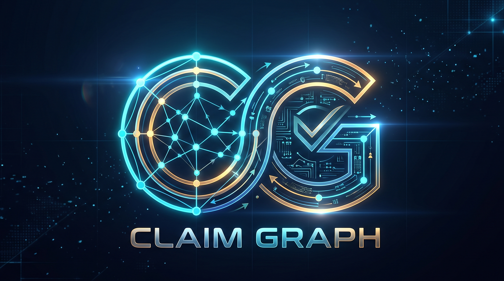

<p align="center">
  
</p>

# CLAIM GRAPH: Evidence & Contradiction Intelligence

An autonomous knowledge graph engine that deconstructs unstructured technical specifications and research documents into testable atomic propositions, tracks temporal contradictions across document revisions, and flags orphaned conclusions whose supporting evidence has fallen.

**🌐 Live Web Application**: [https://claim-graph.netlify.app/](https://claim-graph.netlify.app/)

---

## 🌟 Key Features

- **⚡ Custom Problem Import Hub & Solver**: Ingest multi-version architecture specs, RFCs, and engineering documents via file upload (`.json`, `.txt`, `.md`), text pasting with `---` revision delimiters, or the interactive document card builder. Automatically deconstructs atomic claims, detects temporal invalidations, and solves dependencies.
- **🏢 Enterprise Case Studies & Templates**: Pre-configured high-consequence industry scenarios:
  1. 🏥 **Healthcare HIPAA Audit**: On-premise SAN with hardware AES-256 vs Cloud S3 Object Storage, invalidating zero third-party transmission.
  2. 🛸 **Drone Autonomous Avionics**: Dual differential GPS receivers vs Optical visual odometry, invalidating sub-centimeter GPS hovering guarantee.
  3. 💳 **High-Frequency Fintech Ledger**: Strict 2PC synchronous locking vs Event-sourced CQRS ledger, invalidating immediate balance finality guarantee.
  4. 🧠 **LLM Inference Quantization**: 16-bit FP16 precision weights vs 8-bit INT8 quantized weights, invalidating zero perplexity degradation.
- **🔬 Atomic Claim Extraction**: Parses unstructured document chunks into discrete, testable propositions classified as `FACT`, `SPECIFICATION`, `CONCLUSION`, or `ASSUMPTION`.
- **⏳ Temporal Contradiction Tracking**: Detects direct conflicts across document revisions and chronologically marks older claims as `SUPERSEDED` and same-date conflicts as `CONTRADICTED`.
- **⛓️ Orphan & Invalidation Analysis**: Constructs directed dependency edges `(Premise) -[:DERIVES]-> (Conclusion)`. If a premise is superseded or contradicted, the dependent conclusion is automatically invalidated as `ORPHANED`.
- **🪐 Interactive Knowledge Graph Canvas**: Physics-simulated canvas visualization with real-time force simulation, zoom, pan, node inspection drawer, and color-coded relationship edges.
- **⚡ Dual Inference Engine**:
  - **Fast Semantic / Rule Engine**: High-performance deterministic proposition extractor providing instant zero-latency audits for standalone web and public deployments.
  - **Local AI Mode**: Powered by `gemma3:1b` running locally via Ollama (`http://127.0.0.1:11434`).
- **🧪 Real-Time Conflict Sandbox**: Test arbitrary statement pairs with real-time contradiction reasoning.

---

## 📁 Segregated Architecture & Project Structure

The project is segregated into modular directories separating design tokens, client-side reasoning, UI controllers, and the Python core:

```text
CLAIM-GRAPH/
├── assets/                  # Brand identity, media, and logo assets
│   ├── logo.png             # Official glowing futuristic brand emblem
│   └── favicon.png          # App favicon mark
├── css/
│   └── styles.css           # Curated dark-mode design system & responsive styling
├── js/
│   ├── engine.js            # Proposition extraction, semantic reasoning, & reconciliation
│   └── app.js               # Reactive UI controller, canvas physics, & import hub
├── tests/
│   └── test_engine.py       # Automated unit test suite (extraction, conflicts, orphans)
├── index.html               # Clean, modular web dashboard
├── app.py                   # Python HTTP backend & static asset server
├── tool.py                  # Core ClaimGraph NetworkX engine & Ollama client
├── model.py                 # Pydantic data schemas & state models
├── main.py                  # CLI demonstration script
├── netlify.toml             # Netlify deployment configuration
├── requirements.txt         # Python dependencies
└── README.md                # Project documentation
```

---

## 🚀 Quick Start

### 1. Installation
```bash
pip install -r requirements.txt
```

### 2. Optional: Run Local AI (Ollama)
```bash
ollama run gemma3:1b
```

### 3. Launch Web Application
```bash
python app.py
```
Open **http://localhost:8000/** in your browser. (CLAIM GRAPH also runs 100% in-browser on [claim-graph.netlify.app](https://claim-graph.netlify.app/) with zero dependencies).

### 4. Run Automated Test Suite
```bash
python -m unittest discover tests
```

### 5. CLI Execution
```bash
python main.py
```

---

## 📊 API Reference

- `GET /`: CLAIM GRAPH Web Application
- `GET /health`: Health status & active inference engine
- `GET /api/scenarios`: Built-in benchmark scenarios
- `POST /api/run`: Execute claim audit on benchmark or custom documents
- `POST /api/verify-pair`: Test arbitrary statement pair for contradiction
